<!-- Original profile: Engineering & Algorithms / Nguyen Bao Toan -->
<picture>
  <source media="(prefers-reduced-motion: reduce)" srcset="./assets/hero-static.svg" />
  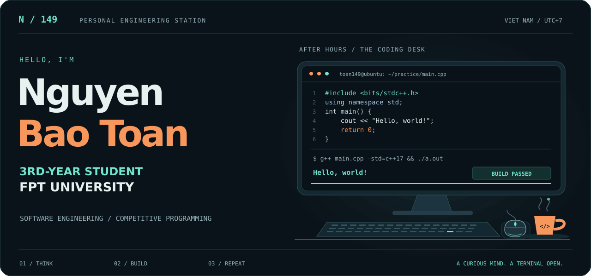
</picture>

<b>Software engineer. Competitive programmer. Curious builder.</b>

  <a href="https://codeforces.com/profile/toan149">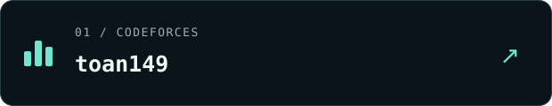</a>
  <a href="mailto:toannb149@gmail.com">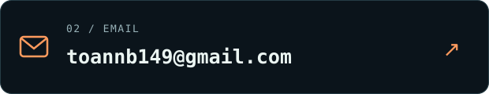</a>
  <a href="https://www.facebook.com/ngbaotoan1204/">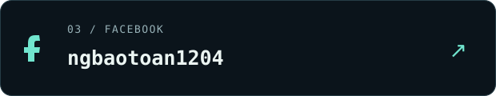</a>
  <a href="https://www.instagram.com/_nberton._/">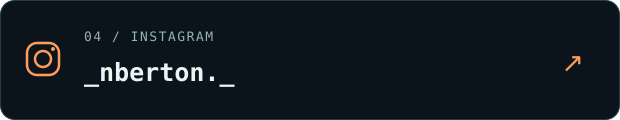</a>

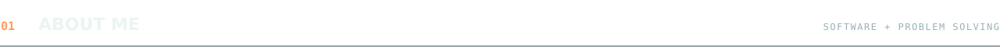

I'm **Nguyen Bao Toan** — a **software engineer**, competitive programmer and **third-year student at FPT University, Can Tho, Viet Nam**.

I build applications, work with databases and create tools for my workflow. Competitive programming keeps my algorithmic thinking sharp.

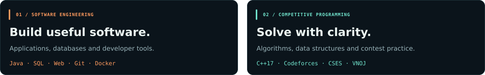

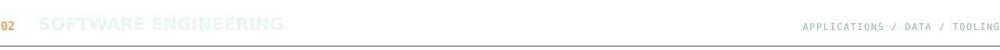

I enjoy connecting interfaces, application logic and data — then improving the code and the development workflow around them.

| Area | Technologies I work with |
| :-- | :-- |
| Java applications | Java · Swing · Maven |
| Backend & server-rendered web | Servlet · JSP · JSTL · JDBC · DAO |
| Web interfaces | HTML · CSS · JavaScript · Bootstrap |
| Databases | SQL Server · SQL · relational data & CRUD workflows |
| Developer tooling | Python · Bash · Sublime Text · VS Code |
| Development environment | Git · GitHub · Docker · Ubuntu |

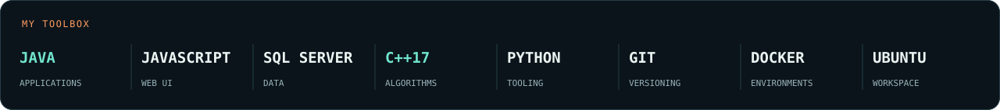

I practice on **Codeforces, CSES and VNOJ**, with **ICPC and OLP** as part of my learning journey. My main contest language is **C++17**.

<a href="https://codeforces.com/profile/toan149">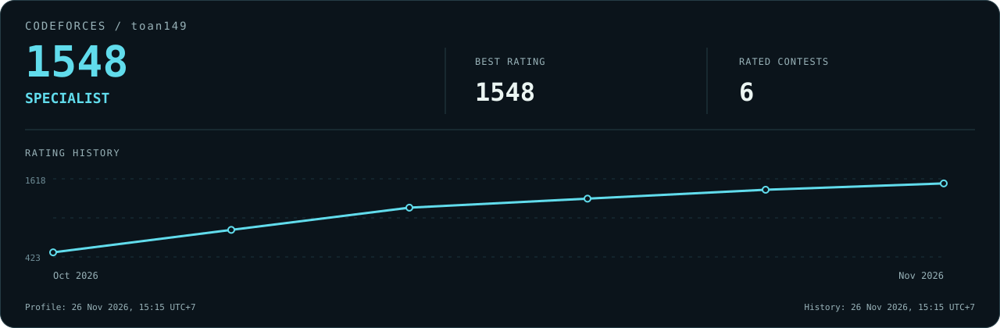</a>

Refreshed from the public Codeforces API. Fetch timestamps are printed on the card; an unavailable API preserves the previous successful snapshot.

  

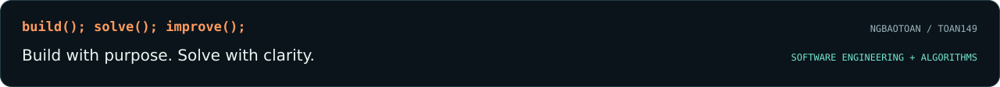
